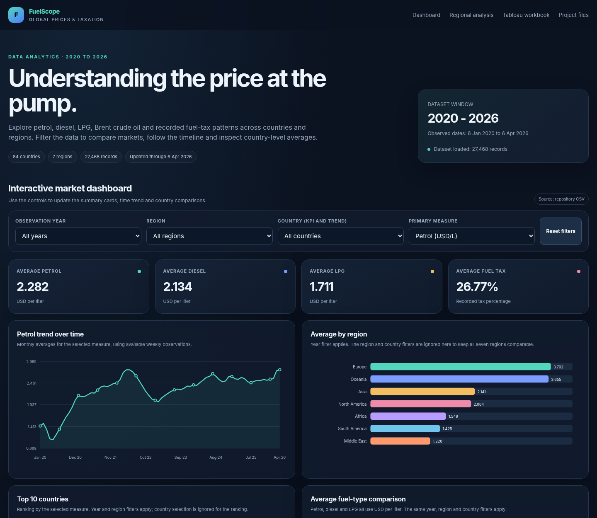

# 🌐 Live Interactive Dashboard

### [🚀 OPEN DASHBOARD](https://architchhabda10-cpu.github.io/global-fuel-prices-taxation-analysis/)

[📂 View GitHub Repository](https://github.com/architchhabda10-cpu/global-fuel-prices-taxation-analysis)

---
# Global Fuel Prices and Taxation Analysis (2020-2026)

A data analytics project exploring petrol, diesel, LPG, Brent crude oil values and recorded fuel taxation across countries and regions. The repository includes a Tableau packaged workbook and an interactive, browser-based dashboard driven by the same CSV dataset.

> **Data window:** 6 January 2020 to 6 April 2026. The dataset does not contain a complete calendar year of 2026.

## Project overview

The project combines a Tableau workbook for the original analytical views with a static web dashboard that can be hosted on GitHub Pages. The browser dashboard supports year, region, country and measure filters, updates KPI cards and charts, and can export filtered rows as CSV.

## Dataset

- **Records:** 27,468
- **Countries:** 84
- **Regions:** 7
- **Distinct observation dates:** 327
- **Fields:** 10
- **Missing values:** none found in the supplied CSV during inspection

| Field | Description |
|---|---|
| `date` | Observation date |
| `country` | Country name |
| `region` | Geographic region |
| `income_level` | Income classification supplied with the data |
| `subsidy_level` | Subsidy classification supplied with the data |
| `petrol_usd_liter` | Petrol price in USD per liter |
| `diesel_usd_liter` | Diesel price in USD per liter |
| `lpg_usd_liter` | LPG price in USD per liter |
| `brent_crude_usd` | Brent crude value in USD per barrel |
| `tax_percentage` | Recorded fuel tax percentage |

## Dataset-level averages

These are arithmetic averages over all source rows; they are not live prices or official national estimates.

| Metric | Average |
|---|---:|
| Petrol | USD 2.282/liter |
| Diesel | USD 2.134/liter |
| LPG | USD 1.711/liter |
| Brent crude | USD 107.982/barrel |
| Recorded tax percentage | 26.774% |

## Interactive dashboard preview

The website is implemented with plain HTML, CSS and JavaScript; charts are drawn as SVG, without relying on a remote charting library. On GitHub Pages, it reads `global_fuel_prices_Dataset.csv` from the repository root. The browser dashboard is a **web-native interactive dashboard**, not an embedded Tableau Public view. The original Tableau workbook is available separately below.

## Tableau workbook

Open `Global_Fuel_Prices_Taxation_Dashboard.twbx` in a compatible version of Tableau Desktop. The uploaded workbook contains 14 distinct worksheet names, three regular dashboards and one Story with three saved Story points: Global Overview, Fuel Trends, and Tax & Country Analysis.

## Project files

| File or folder | Purpose |
|---|---|
| `index.html` | Interactive website/dashboard landing page |
| `global_fuel_prices_Dataset.csv` | Source data used by the web dashboard |
| `Global_Fuel_Prices_Taxation_Dashboard.twbx` | Packaged Tableau workbook |
| `DASHBOARDPREVIEW.png` | Ready-to-open project preview image |
| `PROJECT_REPORT.pdf` | Project overview, dataset, findings, charts and testing summary |
| `PERFORMANCE_TESTING.md` | Local browser smoke-test method and results |
| `performance-test-results.json` | Machine-readable results from the test run |
| `sql/01_create_database_and_table.sql` | MySQL database/table setup |
| `sql/02_validation_queries.sql` | SQL validation and summary queries |
| `tests/test_dashboard.py` | Browser smoke test for the web dashboard |
| `assets/dashboard-preview.png` | Browser viewport screenshot of the web dashboard |
| `assets/dashboard-overview.png` | Upper dashboard area for documentation |
| `assets/tableau-story-preview.png` | Screenshot of the current Tableau Story |

## How to open locally

1. Keep `index.html` and `global_fuel_prices_Dataset.csv` in the same folder.
2. Open `index.html` through a local web server or host the repository with GitHub Pages. A server is recommended because browsers may block `fetch()` from a `file://` URL.
3. In the repository root, you can start a simple local server with Python: `python -m http.server 8000`, then browse to `http://localhost:8000`.
4. Use the Year, Region, Country and Primary Measure filters. The filtered-row count updates, and the Download filtered rows button exports the selected records.

## Publish the website using GitHub Pages

After uploading these files to the `main` branch:

1. Open the repository on GitHub and choose **Settings**.
2. Open **Pages** in the left sidebar.
3. Under **Build and deployment**, select **Deploy from a branch**.
4. Choose branch `main` and folder `/(root)`, then click **Save**.
5. Wait for GitHub Pages to finish deployment. The expected URL is `https://architchhabda10-cpu.github.io/global-fuel-prices-taxation-analysis/`.

The URL will not work until Pages is enabled and deployment succeeds. Confirm the CSV and workbook are okay to publish publicly before enabling Pages.

## MySQL validation

The `sql` folder contains starter table setup and validation queries. Review the column types and database name for your installation before running. Import the CSV with MySQL Workbench's Table Data Import Wizard or a configured local-infile workflow. Never place a MySQL password in SQL scripts or commit it to GitHub.

## Performance and testing

A local Chromium smoke test was run against the web dashboard with the full dataset. It checked initial render, four charts, seven-region summary, year/region/country filters and the CSV download action. See [PERFORMANCE_TESTING.md](PERFORMANCE_TESTING.md) and [performance-test-results.json](performance-test-results.json). The recorded timings exclude real HTTP dataset transfer and must not be presented as a hosted Lighthouse score or production SLA. A hosted test should be completed after GitHub Pages deployment.

## Key limitations

- The dataset has not been independently reconciled with official statistics; verify its source and license before redistribution.
- Cross-country differences and co-movement do not establish causal relationships.
- Average values are computed across source observations, without weighting for population or consumption.
- The web dashboard is static/client-side and does not use a backend API or live data feed.
- A separate Tableau Public dashboard is not currently embedded; the `.twbx` workbook is available for download and local opening.

## Future improvements

- Publish and test a hosted Tableau Public view if permitted by the dataset license and Tableau account.
- Capture final live-site Lighthouse/DevTools performance results.
- Add an independently sourced data provenance note and appropriate license.
- Extend the analysis with additional validated data sources and documented SQL analysis.

## Author

**Archit Chhabda**  
B.Tech Computer Science and Engineering

## Data attribution and license

The original source-data citation and redistribution license were not included in the supplied files. Add them here before redistributing data if you have the source details.
